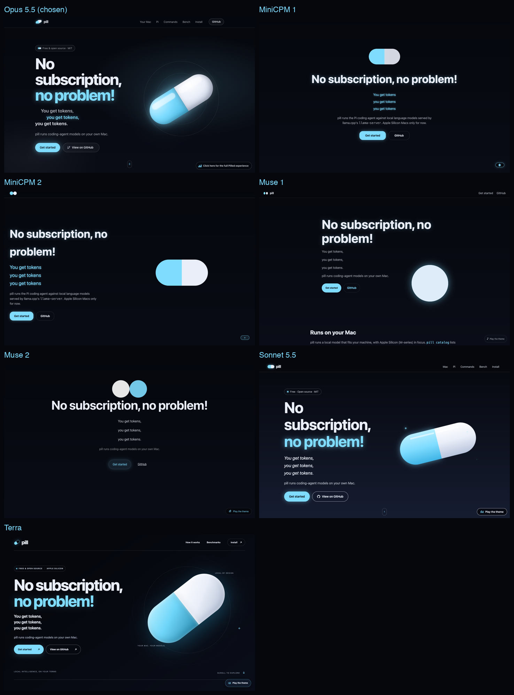

# Landing page variants

Seven versions of the pill landing page were built side by side from the same brief, one per model run, and compared before choosing. Only the winner (Opus 5.5) is kept as the live site in `site/`; the rest were removed and survive in this repository's git history (the commit that added them is the first of the landing page pull request).

| Variant | Notes |
| --- | --- |
| Opus 5.5 | Chosen. Floating capsule hero, tiered benchmark staircase, install steps. |
| MiniCPM 1 | Compact, centred hero with a split capsule. |
| MiniCPM 2 | Left-aligned hero with a split capsule. |
| Muse 1 | Minimal hero with a glowing disc. |
| Muse 2 | Centred hero with two animated halves. |
| Sonnet 5.5 | Large glossy capsule hero, close to Opus. |
| Terra | Large capsule with a vertical install sequence. |

Screenshots show the first screen at 1440 x 900 after the entrance animation settled.
