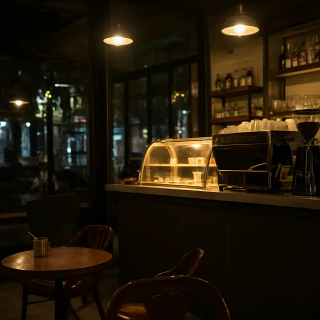
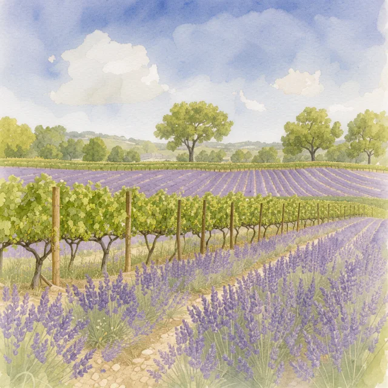

# Image-generation benchmark

Dev tooling for comparing local text-to-image models. It is separate from the coding and chat evals in
`../` and from the `pill` binary: own prompts, own scorer, own results folder (`../results/imagegen/`, gitignored).
The only shared code is `MemorySampler`, imported read-only from `../run.py`.

> **Licence warning.** The models tested here have restricted licences. Qwen-Image 2.1 (Qwen Research Licence)
> and FLUX 3 Image Klein (FLUX Kommunity Licence v1.0, tested in rounds 1 and 3, dropped since) are, as far as we know, for non-commercial and
> research use only. Z-Image Turbo and FLUX.2 klein 4B are listed as Apache 2.0 on their model cards (not re-checked in this run). Do not use these images or models commercially. Read each model's current licence before
> relying on this summary, and check the licence of any model you add.

## What it does

Every model gets the same three prompts (`prompts.json`, or the file named by `IMAGEGEN_PROMPTS`, e.g.
`prompts-round3.json`), three seeds (7, 42, 1234) at 1024x1024. FLUX 3 Image Klein was dropped after round 3
(captain's call, human mean 3.44); the runner supports Qwen Turbo (default), FLUX.2 klein 4B and the other Draw Things models.

**Standing prompt rules** (`build_prompt`, on by default, `--plain` turns them off). The captain's prompt is kept
verbatim in `results.json` as `prompt`; what the model got is saved beside it as `prompt_sent`; the judge sees only `prompt`.
1. Every prompt ends with a short no-text sentence ("No text, letters, numbers or logos anywhere. All surfaces are
   plain and unmarked; nothing is written on anything."), because lettering in these models comes out garbled. It
   cuts lettering but does not remove it: see the report. Exact text is sent only when the user has confirmed what it
   says and where, using `--plain` with the text in the prompt. Consequence: a magazine cover gets no masthead or cover lines.
2. FLUX.2 klein 4B only, and only when the prompt says "realistic" or "photographic", a documentary-photo cue
   is added, because its realistic scenes came out glossy and game-like. Qwen gets no cue. Per image it records seconds, peak memory (`/usr/bin/time -l`) and the system's free
memory and swap. Opus 5.5 scores each image 0 to 5 on subject, style, setting, technical quality and composition
(25 in total), seeing only the prompt and the image. A blind sheet lets a person rate the same images 1 to 5.

## Re-run it

```bash
pill stop                                             # one local model at a time on this machine
python3 evals/imagegen/imagegen.py run qwen-turbo     # or flux2-klein-4b, z-image-turbo (qwen-image-2512 does not fit in 24 GB); --plain sends prompts verbatim
python3 evals/imagegen/imagegen.py judge <run-dir> [<run-dir>...]     # Opus 5.5, uses the Claude plan allowance
python3 evals/imagegen/imagegen.py blind <run-dir> [<run-dir>...]     # sheet.html to rate, key.json to open afterwards
python3 evals/imagegen/imagegen.py validate agreement ratings-imagegen.json key.json <run-dir> [<run-dir>...]
python3 evals/imagegen/imagegen.py selftest           # whole pipeline with a fake generator, no model, no cost
python3 -m unittest discover -s evals/imagegen        # unit tests: prompt rules, six-option command (no model)
```

## Six options for a request

Standing rule: for any image request, generate with both kept models, three variants each, and pick the best.

```bash
python3 evals/imagegen/imagegen.py options "your prompt"     # about 7 minutes
```

It runs Qwen Turbo for 3 images, then FLUX.2 klein 4B for 3 (one model at a time, each preceded by a memory check
that waits for 20 percent free and no other model server), with fresh random seeds. `evals/results/imagegen/options/<stamp>/`
gets `pick.html` (all six with model and seed), `options.json` (seeds and sent prompts, so any favourite can be re-made
with `run`-style settings) and the PNGs.

Other checks: `validate determinism <model>` (same seed twice, free) and `validate judge <run-dir>...`
(matched against mismatched prompts and order swap, uses Opus). Needs `draw-things-cli` (`brew install draw-things-cli`).

## Add a new model

1. In `imagegen.py`, add a branch to `backend_cmd` that returns the command line for that model
   (prompt, seed, 1024x1024 and output path), and add its name to the `unknown model` message.
2. For a Draw Things model, fetch it first: `draw-things-cli models ensure --model <file>.ckpt`.
3. Run, judge, build the blind sheet with the old and new run folders together, then rate it.
4. Add a section to `../reports/image-generation.md` (TLDR first, see `../reports/summary-template.md`) and
   the best sample per prompt below.

## Best sample per prompt

Chosen by the captain's blind rating, then the Opus score. Images are 640 px WebP copies of the 1024 px outputs.
Full results and caveats are in [`../reports/image-generation.md`](../reports/image-generation.md).

| Prompt | FLUX 3 Image Klein (4-bit S, Draw Things) | Qwen-Image 2.1 Turbo (4-bit S, 8 steps) |
|---|---|---|
| realistic style, representation of a coffee shop at night | <br>seed 7, human 4, Opus 18 | <br>seed 1234, human 5, Opus 23 |
| cartoon chef cooking Halloween potions, anime style | <br>seed 7, human 4, Opus 17 | <br>seed 1234, human 5, Opus 19 |
| watercolour style French vineyard and field of lavender | <br>seed 7, human 5, Opus 21 | <br>seed 42, human 5, Opus 21 |

Known weakness: text inside an image (signs, labels) often comes out as gibberish in both models, which is why
the runner now adds a no-text sentence to every prompt. The samples above are FLUX 3 Klein and Qwen from round 1, before that rule.
