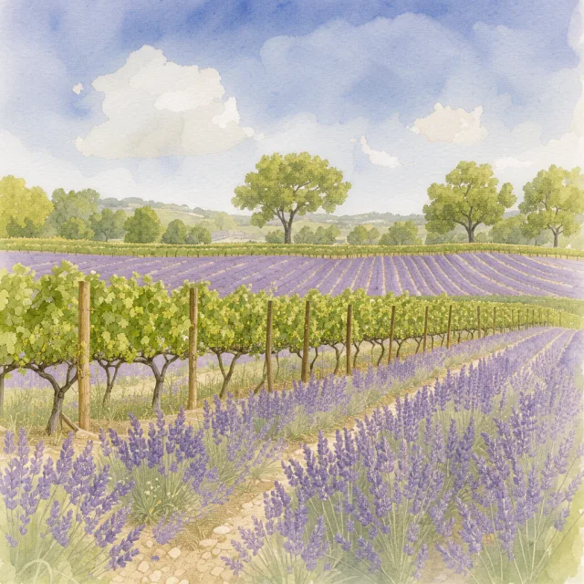

# Image-generation benchmark

Dev tooling for comparing local text-to-image models. It is separate from the coding and chat evals in
`../` and from the `pill` binary: own prompts, own scorer, own results folder (`../results/imagegen/`, gitignored).
The only shared code is `MemorySampler`, imported read-only from `../run.py`.

> **Licence warning.** The models tested here have restricted licences. FLUX 3 Image Klein (FLUX Kommunity
> Licence v1.0) and Qwen-Image 2.1 (Qwen Research Licence) are, as far as we know, for non-commercial and
> research use only. Do not use these images or models commercially. Read each model's current licence before
> relying on this summary, and check the licence of any model you add.

## What it does

Every model gets the same three prompts, verbatim, with no added style words (`prompts.json`), three seeds
(7, 42, 1234) at 1024x1024. Per image it records seconds, peak memory (`/usr/bin/time -l`) and the system's free
memory and swap. Opus 5.5 scores each image 0 to 5 on subject, style, setting, technical quality and composition
(25 in total), seeing only the prompt and the image. A blind sheet lets a person rate the same images 1 to 5.

## Re-run it

```bash
pill stop                                             # one local model at a time on this machine
python3 evals/imagegen/imagegen.py run flux3          # or qwen-turbo
python3 evals/imagegen/imagegen.py judge <run-dir> [<run-dir>...]     # Opus 5.5, uses the Claude plan allowance
python3 evals/imagegen/imagegen.py blind <run-dir> [<run-dir>...]     # sheet.html to rate, key.json to open afterwards
python3 evals/imagegen/imagegen.py validate agreement ratings-imagegen.json key.json <run-dir> [<run-dir>...]
python3 evals/imagegen/imagegen.py selftest           # whole pipeline with a fake generator, no model, no cost
```

Other checks: `validate determinism <model>` (same seed twice, free) and `validate judge <run-dir>...`
(matched against mismatched prompts and order swap, uses Opus). Needs `draw-things-cli` (`brew install draw-things-cli`).

## Add a new model

1. In `imagegen.py`, add a branch to `backend_cmd` that returns the command line for that model
   (prompt, seed, 1024x1024 and output path), and add its name to the `unknown model` message.
2. For a Draw Things model, fetch it first: `draw-things-cli models ensure --model <file>.ckpt`.
3. Run, judge, build the blind sheet with the old and new run folders together, then rate it.
4. Add a section to `../reports/image-generation.md` (TLDR first, see `../reports/summary-template.md`) and
   the best sample per prompt below.

## Best sample per prompt

Chosen by the captain's blind rating, then the Opus score. Images are 640 px WebP copies of the 1024 px outputs.
Full results and caveats are in [`../reports/image-generation.md`](../reports/image-generation.md).

| Prompt | FLUX 3 Image Klein (4-bit S, Draw Things) | Qwen-Image 2.1 Turbo (4-bit S, 8 steps) |
|---|---|---|
| realistic style, representation of a coffee shop at night | <br>seed 7, human 4, Opus 18 | <br>seed 1234, human 5, Opus 23 |
| cartoon chef cooking Halloween potions, anime style | <br>seed 7, human 4, Opus 17 | <br>seed 1234, human 5, Opus 19 |
| watercolour style French vineyard and field of lavender | <br>seed 7, human 5, Opus 21 | <br>seed 42, human 5, Opus 21 |

Known weakness: text inside an image (signs, labels) often comes out as gibberish in both models, more often in
FLUX 3 Klein.
