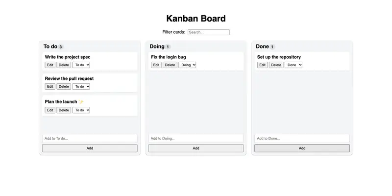
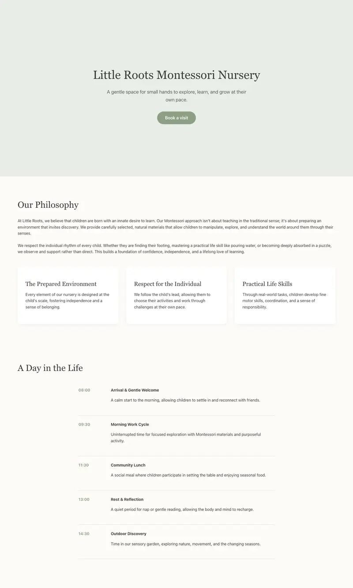

# Gemma 4 26B-A4B, UD-IQ3_S (11.3 GB)

**Setup:** Gemma 4 26B-A4B instruction-tuned, Unsloth `UD-IQ3_S` quantisation, 64k context, llama.cpp through pill, driven by Pi
with thinking off. This is the local comparison for MiniCPM, not a full report.
**Runs:** **one run per Tier 3 task** (so every figure below is a single run), plus pill's 3-run gate. Same machine as the MiniCPM report.

## In one paragraph

Good at what it finished (a perfect Kanban board and a nursery page of 92 in under 4 minutes each), but it timed out on four of the
seven tasks and failed pill's 3-run gate on the time cap. In the transcripts it was still working (21 to 47 tool calls, no loops),
so the problem is throughput on long tasks, not getting stuck.

## Strong points

- **Web UI when it finishes:** Kanban 100 (3.6 minutes), nursery landing 92 (3.9 minutes, rated Good by eye). Single runs.
- **Memory headroom:** minimum free memory 19% with no swap in the gate runs, 24 tok/s.
- **Tier 2 correctness:** 22/22 on the tic-tac-toe build in all three gate runs.

## Weak points

- **Time cap:** 4 of 7 Tier 3 runs timed out (Go at 30 minutes; insight, Mars and tax at 40 minutes) and two of three gate runs went over the 15-minute cap.
- **Whatever times out scores low:** Go 13, insight 0 (no report written), Mars 3 and tax 3 (the build did not complete).
- **Cleaning:** 68 (7.5 minutes).
- Other Gemma 4 builds failed pill's gate on swap or memory (Q3_K_XL: 4.8 to 7.7 GB swap, 6% free memory on the failing run; IQ4_XS: 9% free).

## Scores per task (single runs)

| Task | Score | Minutes |
|---|---|---|
| `go-notes` | 13 (timeout, 30 min cap) | 30 |
| `py-clean` | 68 | 7.5 |
| `py-insight` | 0 (timeout, no report; judge 0) | 40 |
| `web-kanban` | 100 | 3.6 |
| `web-landing-nursery` | 92 | 3.9 |
| `web-landing-mars` | 3 (timeout, build failed) | 40 |
| `web-landing-tax` | 3 (timeout, build failed) | 40 |

## What it looks like

| Task | Screenshot | Automated | Blind rating |
|---|---|---|---|
| Kanban (five cards added through the UI) |  | 100 | not rated |
| Nursery landing page |  | 92 | Good |
| Mars landing page | build failed (timeout), no image | 3 | not rated |
| Tax landing page | build failed (timeout), no image | 3 | not rated |

## Recommended use

- **Good fit:** short front-end builds where speed to a first result matters, as an optional fallback when memory headroom matters.
- **Poor fit:** anything long (Go feature, data analysis, multi-page work) unless the time cap is raised; it is not established that it would finish.

## Caveats

One run per task, so "Gemma is better at front-end" is not established; a rerun could differ by tens of points (MiniCPM's did). The
timeouts are caps, not crashes; with a longer cap the long tasks might have finished. The machine carried other load during part of the gate runs.
