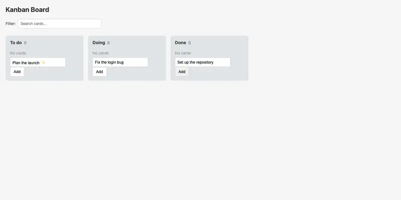
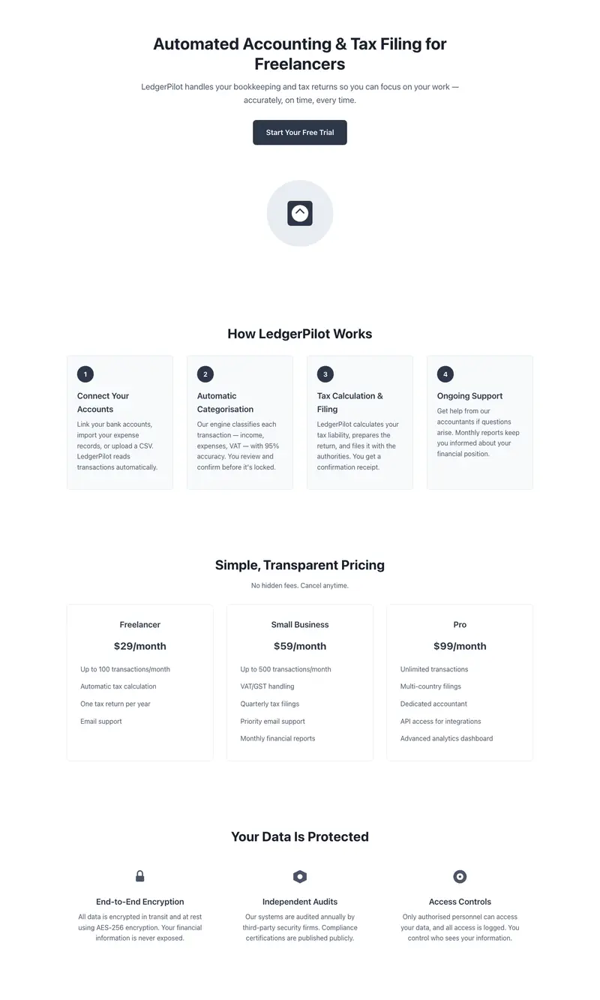

# MiniCPM-V 4.7 35B-A3B, IQ2_XS-IQ2_XXS (11.3 GB)

**Setup:** OpenBMB MiniCPM-V 4.7, a 35B mixture-of-experts model with about 3B active parameters, in the AtomicChat
`AD-IQ2_XS-IQ2_XXS` quantisation (about 2.6 bits per weight), 64k context, served by llama.cpp through pill and driven
by Pi with thinking off. Vision (mmproj) was not exercised: every test is text and tool-calling.
**Runs:** 6 per task (a first run plus five rounds), 42 runs, on a 24 GB Apple Silicon Mac. Cloud baselines have one run each.

## In one paragraph

A usable local default for well-specified build work: landing pages, a small app, a feature in a known codebase and
data cleaning all had medians of 88 to 98 out of 100, it never crashed, and it ran with 22% memory free and no swap. It is
unreliable in a way that needs review (about one run in five outside the insight task scored under 70, with no warning)
and clearly weak at open-ended data analysis, where an Opus judge scored all six reports 9 to 30 out of 100.

## Strong points

- **Fits the machine.** Passed pill's 5-run gate (22/22 on the tic-tac-toe build, minimum free memory 22%, no swap, 25 tok/s). The larger
  13.7 GB quant failed on swap; this one is the pill default.
- **Finishes long tasks.** 2 timeouts in 42 Tier 3 runs (both Go, at the 30 minute cap), against 4 in 7 for Gemma 4.
- **Landing pages.** Medians 93 (nursery), 95 (Mars) and 98 (tax) automated. Mars and tax were rated Ok by eye on the first run.
- **Kanban.** Median 90 of 100; four of six runs scored 90 or more.
- **Go feature in a known codebase.** Median 88 (67 to 94), reading the code and following pill's conventions.

## Weak points

- **Open-ended analysis.** `py-insight` automated 40 to 60 in all six runs; Opus judge 9, 12, 15, 19, 20, 30. Of seven planted patterns it
  found the growth trend in 6 of 6 reports (4 correctly), Enterprise economics 5 of 6, channel churn 4 of 6 (1 correctly), seasonality,
  ticket effects and early churn once each, and the September 2024 price increase **0 of 6**. Its churn model trains on the same customers it
  labels as churned (AUC 1.0, a leak), and channel clean-up never reached its charts.
- **Occasional bad runs.** Scores under 70: Go 67, cleaning 57 and 63, Kanban 40 and 52, nursery 31 and 18, tax 54 (8 of 36 runs outside insight).
- **Looks.** The first run's pages were rated Bad (nursery), Ok (Mars) and Ok (tax) in a blind rating, while the Cloud models were
  Excellent or Good. Only that first run was rated.
- **Speed on code and data.** 17 to 22 minutes per run on Go and cleaning, against 1 to 2 for cloud models; web tasks take 3.5 to 6 minutes.

## Scores per task

| Task | Runs | Median | Range | Timeouts | Mean minutes |
|---|---|---|---|---|---|
| `go-notes` | 6 | 88 | 67–94 | 2 | 21.8 |
| `py-clean` | 6 | 90.5 | 57–96 | 0 | 17.4 |
| `py-insight` (automated) | 6 | 40 | 40–60 | 0 | 13.7 |
| `py-insight` (Opus judge) | 6 | 17 mean | 9–30 | n/a | n/a |
| `web-kanban` | 6 | 90 | 40–92 | 0 | 3.5 |
| `web-landing-nursery` | 6 | 93 | 18–96 | 0 | 6.1 |
| `web-landing-mars` | 6 | 95 | 87–100 | 0 | 6.3 |
| `web-landing-tax` | 6 | 98 | 54–100 | 0 | 5.9 |

The Opus judge is noisy: the same first insight report scored 12 on one pass and 20 on another.

## What it looks like

Screenshots are the **first** run of each task (the one that was rated); the later rounds scored differently, see the range above.

| Task | Screenshot | Automated | Blind rating |
|---|---|---|---|
| Kanban (five cards added through the UI) |  | 40 (cards added with the Add button never appeared) | not rated |
| Nursery landing page |  | 31 | Bad |
| Mars landing page |  | 96 | Ok |
| Tax landing page |  | 98 | Ok |

## Thinking on or off

Every table above is thinking **off**. Rerunning with thinking on (22 runs, `pi:<model>:medium`) gave no measurable gain: the median is equal or
lower on six of seven tasks, one Go run hit the 30-minute cap, and the Opus judge scored the insight reports 17, 7 and 15 (thinking off:
about 20). Memory is the same either way (system-wide minimum free 9% on, 10% off, on a machine already under pressure), because thinking costs
time, not memory. **Recommendation: keep thinking off.** The full table and the memory comparison are in `summary.md`.

## Recommended use

- **Good fit:** well-specified, self-contained builds you will review anyway (small front-end pages and apps, adding a feature to a
  codebase it can read, cleaning data against a clear spec); offline or private work; a local default on a 24 GB machine.
- **Poor fit:** open-ended data analysis or modelling; anything that will not be reviewed (about one run in five fails badly);
  design judgement; vision tasks (untested).

## Caveats

Six runs per cell is still small. The automated landing score checks structure, accessibility and responsiveness, and overstated
quality on the first run. The Opus judge is a single sample per report. Local runs used Pi with thinking off in a throwaway config;
the machine was otherwise quiet. Vision was not tested.
