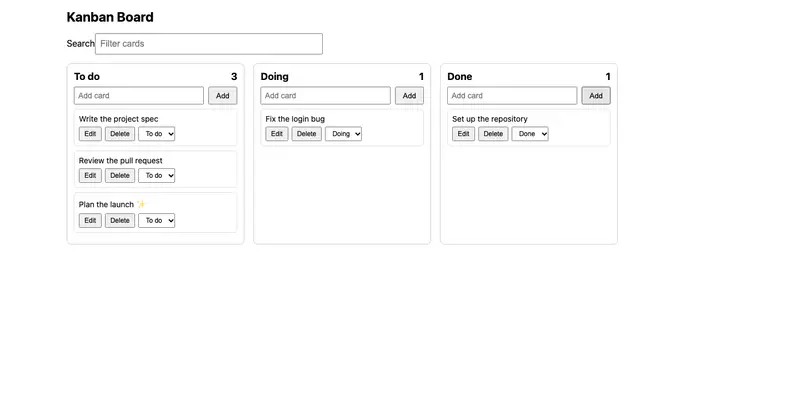
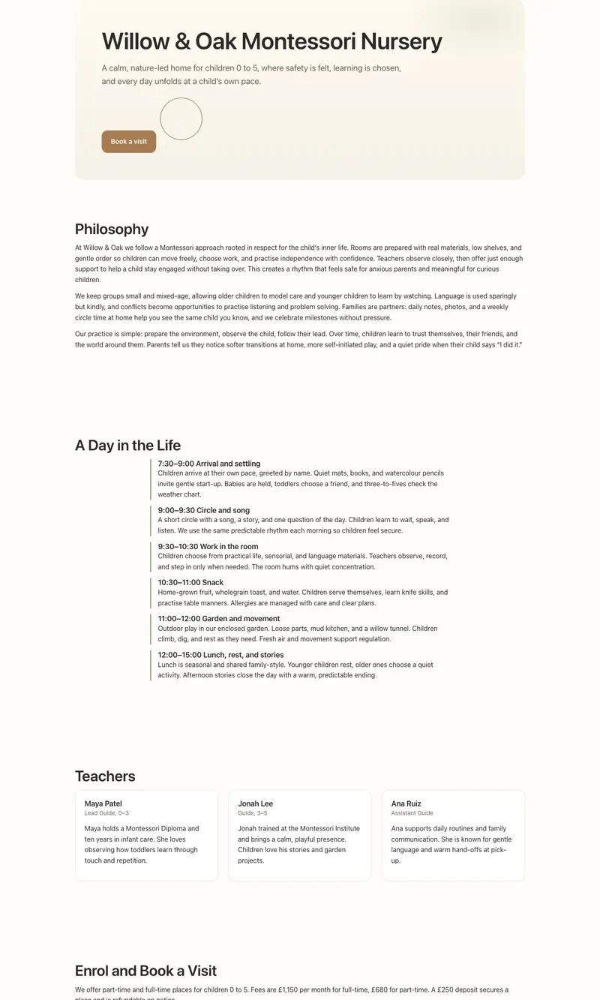
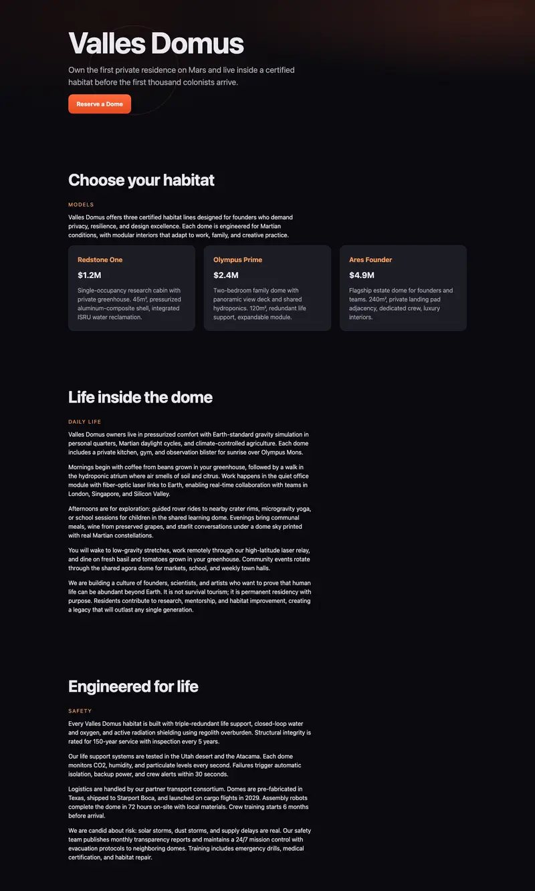
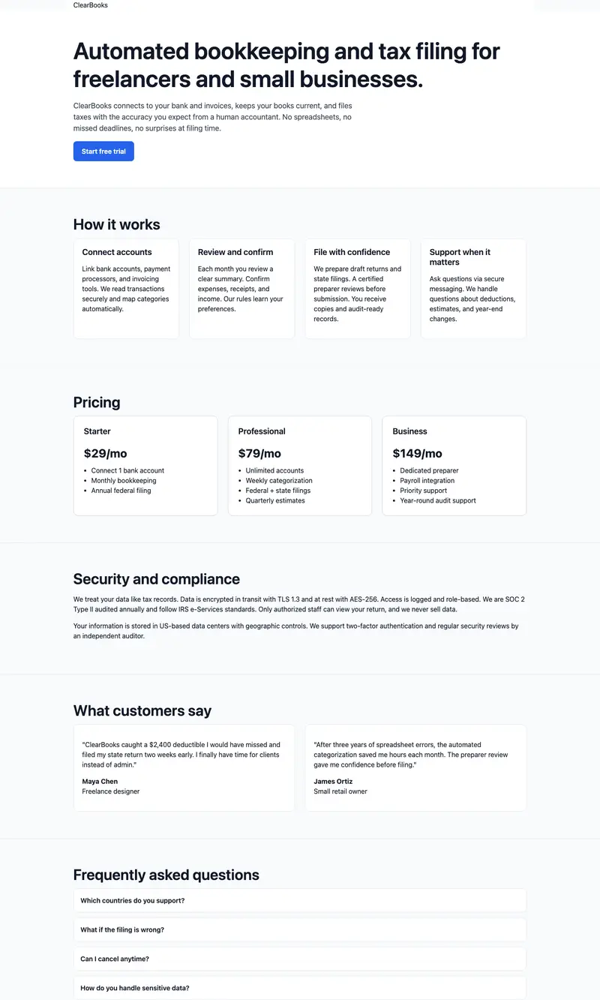

# Meta Muse Glimmer 30B, UD-IQ2_XXS (10.7 GB), 64k context, DFlash drafter

## TLDR

**Verdict:** Not a good model to replace MiniCPM. In one Tier 3 run it matched or beat MiniCPM's median on two
landing pages (nursery 99, Mars 100) but timed out on Go (77) and data cleaning (53), and took two to three times as long.

| Check | Result |
|---|---|
| Tier 1 gate | Fail at the default 60 s: 107–111 s in 3 of 3 runs (passed only the relaxed 300 s limit) |
| Tier 2 (22 tasks; champion bar 22/22) | 22, 22, 22 (5.9, 6.3 and 13.2 minutes) |
| Tier 3 (7 tasks) | One run: Go 77 (timeout), cleaning 53 (timeout), insight 35, Kanban 84, nursery 99, Mars 100, tax 90 |
| Quality | Ahead of MiniCPM's 6-run median on 2 of 7 tasks, behind on 5; single run |
| Time | Tier 3: 7–17 minutes on web tasks, 21–30 elsewhere; decode about 12 tok/s with the drafter (6.8 without) |
| Memory pressure | Minimum free memory 12–17%; swap up 3.9 GB on Go, under 0.2 GB on every other task |

**Against the champion:** MiniCPM-V 4.7 IQ2 medians over 6 runs are Go 88, cleaning 90.5, insight 40, Kanban 90,
nursery 93, Mars 95, tax 98, at 3.5–22 minutes per task, and it passes the default gate.

## Details

- **Setup:** Pi with Muse's thinking reduced (a chat-template copy that pre-fills an empty reasoning message, plus
  `reasoning_strength` low; see `tried-and-rejected.md`), 64k context, Unsloth UD-IQ2_XXS (10.7 GB) with Unsloth's
  DFlash drafter (1.6 GB) through llama.cpp build 11960 and pill 0.4.1, 24 GB M4. Same tasks and caps as the other models.
- **Runs:** one run per task, 30 to 31 October 2026, overnight on an otherwise idle machine. Go and cleaning hit their
  30-minute caps while still working (106 and 169 agent turns, no loops); the other five finished. The insight task
  was not graded by the Opus judge and the landing pages were not rated blind.
- **Discarded run:** an earlier run the same evening scored 33, 0 and 0 on the first three tasks. A Pi process left
  over from an aborted launch was sharing the model, so each turn reprocessed about 15,000 tokens of prompt (about 4.5
  minutes) and the agents managed 6 or 7 turns per task. Those results are excluded.
- **Caveats:** single run, so differences of a few points are not findings; MiniCPM's own runs vary by tens of points.
  With longer caps Go and cleaning might have finished. Muse would still fail the default Tier 1 limit, because
  drafting speeds up decoding but not prompt processing.

## What it looks like

| Task | Screenshot | Automated | Blind rating |
|---|---|---|---|
| Kanban (five cards added through the UI) |  | 84 | not rated |
| Nursery landing page |  | 99 | not rated |
| Mars landing page |  | 100 | not rated |
| Tax landing page |  | 90 | not rated |

## Sources

Gate runs and setup: [`tried-and-rejected.md`](tried-and-rejected.md#nemotron-35-bolt-e4b-and-muse-glimmer-30b-2026-10-29).
Comparison: [`summary.md`](summary.md). Raw runs are in `evals/results/` (not committed), folders `20261030T224809`
to `20261031T022153` for agent `pi:muse-glimmer-30b-iq2xxs-64k`.
