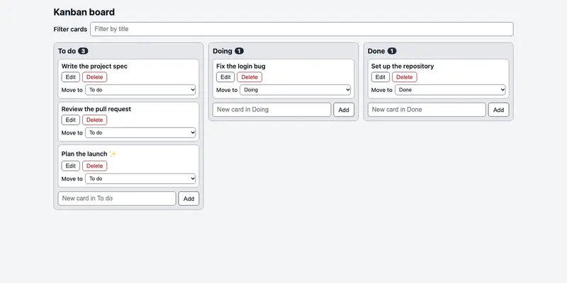
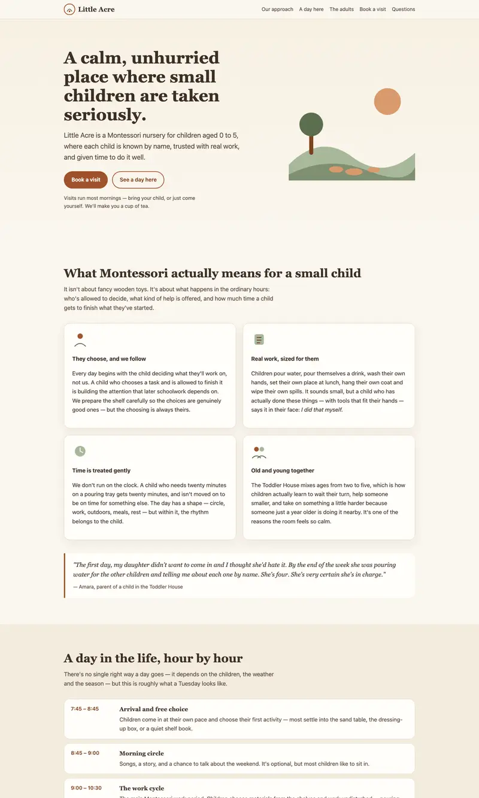
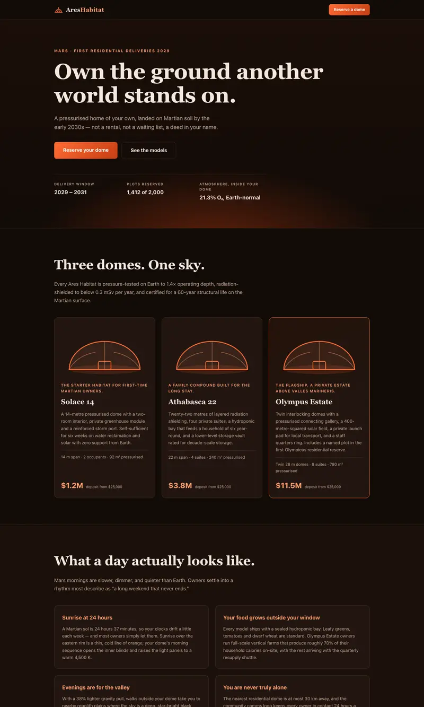

# Qwen3.8 27B pi-adapted LoRA on UD-IQ3_XXS (10.9 GB), 32k context, thinking off

## TLDR

**Verdict:** Not adopted as the default, but the best Tier 3 profile of any local model tested here. With the base
model's MTP head added, one Tier 3 run beat MiniCPM's six-run median on 5 of 7 tasks (Go 100, cleaning 100, insight
53, Kanban 95, Mars 100). Tier 1 still takes 143–157 s against the 60 s default, whatever the batch size, context or
MTP setting, and Tier 3 tasks take 1.2 to 5.5 times as long as MiniCPM's. MiniCPM stays the default.

| Check | Result |
|---|---|
| Tier 1 gate | Fail at the default 60 s: 146, 138 and 146 s, 3 of 3 runs passed only the relaxed 300 s limit |
| Tier 2 (22 tasks; champion bar 22/22) | 22, 22, 22 (relaxed 30-minute cap, no MTP) |
| Tier 3 (7 tasks, with MTP) | One run: Go 100, cleaning 100, insight 53 (timeout), Kanban 95, nursery 54, Mars 100, tax 96 |
| Quality | Ahead of MiniCPM's median on 5 of 7 tasks, behind on nursery (54 vs 93) and tax (96 vs 98); single run |
| Time | Tier 3 15–34 min per task, insight at its 40-min cap; decode 12.4–13.6 tok/s with MTP, 6.5 without |
| Memory pressure | Tier 3 minimum free memory 12–16%; swap up 0.87 GB on cleaning, 0.16 GB on Go, 0 elsewhere |

**Against the champion:** MiniCPM-V 4.7 IQ2 passes the default gate on this machine (Tier 1 under 60 s, 22/22 in about
5 minutes, about 28 tok/s) and its Tier 3 medians are Go 88, cleaning 90.5, insight 40, Kanban 90, nursery 93, Mars 95,
tax 98 in 3.5–22 minutes per task.

## Details

- **Model:** [harness-hub/Qwen3.8-27B-pi-adapted](https://huggingface.co/harness-hub/Qwen3.8-27B-pi-adapted), a LoRA
  (r 32, alpha 64, all attention and MLP projections) trained with reinforcement learning to drive the Pi coding agent,
  released 16 November 2026. Its card reports Terminal-Bench 2.1 39.5% to 55.8% and 55–62% fewer tool calls under Pi.
  The F16 GGUF adapter (`Qwen3.8-27B-pi-lora-F16.gguf`, 319 MB, from `harness-hub/Qwen3.8-27B-pi-adapted-GGUF`) is
  loaded at runtime on a GGUF of the base model; there is no merged GGUF.
- **Setup:** Pi 1.5.2, thinking off (as the adapter was trained), 32k context, no MTP, llama.cpp build 12359, pill 0.6.0,
  24 GB M4. Unsloth `Qwen3.8-27B-UD-IQ3_XXS.gguf` as the base, with the adapter in the model's preset:

  ```toml
  [model.preset]
    chat-template-kwargs = '{"enable_thinking":false}'
    lora = "~/.pill/adapters/Qwen3.8-27B-pi-lora-F16.gguf"   # full path in models.toml
  ```

  The same greedy request gave a different answer with the adapter's scale set to 0, so the adapter was active.
- **Why IQ3_XXS:** UD-IQ4_XS (14.3 GB) plus the adapter loaded, but left 10–11% free and pushed swap from 0.7 to 6.2 GB
  while other apps were open, so it was not benchmarked. The card notes that lower-bit bases drift further from the
  trained behaviour; the results above are therefore a lower bound for the adapter.
- **Runs:** 18 November 2026, three cold runs at the relaxed gate (300 s, 30 min, memory floor 7%). Run 2 reached 22/22
  but was still working at the 30-minute cap (39 tool calls). No run repeated a tool call in a loop. The Tier 1 answer
  (informational) was right in run 1, a bare `2` in run 2 and unfinished in run 3.
- **Against the base model:** the base UD-IQ3_XXS without the adapter scored 22, 22 and 20 (two at the cap) on 25 October;
  the base UD-IQ4_XS and Dynamic 3.1 quants never scored 22/22 in every run and used 52–97 tool calls. Tier 1 is the
  same, as expected: the adapter does not change the dense model's prompt processing.
- **Caveats:** three Tier 2 runs, one setup; the base comparisons ran on other days and builds.

## Speed probe: batch size, context and MTP

Tier 1 is one 7,364-token request from a cold start. Each setup below was measured once cold and once warm (cache
bypassed with a unique prefix), then on decode: 128 forced tokens and a 300-token Go answer. 19 November 2026,
build 12359, 24 GB M4, nothing else loaded.

| Setup (all with the adapter) | Cold s | Warm s | Prompt tok/s | Decode tok/s | Drafts accepted | Min free |
|---|---|---|---|---|---|---|
| ubatch 512 (default), 32k | 146.7 | 140.5 | 53 | 6.5 | – | 18% |
| ubatch 1024, 32k | 143.2 | 149.2 | 52 | 6.5 | – | not recorded |
| ubatch 2048, 32k | 156.8 | 146.0 | 51 | 6.5 | – | not recorded |
| MTP head, ubatch 512, 32k | 152.2 | 145.4 | 51 | 13.6 (count), 12.4 (code) | 94/97, 214/253 | 14% |
| ubatch 2048, 16k | 146.6 | 154.9 | 51 | 6.5 | – | 26% |

- **Batch size and context do not help Tier 1.** Prompt processing stays at 51–53 tok/s from ubatch 512 to 2048, and
  cold and warm times match, so the cost is compute on the dense 27B, not loading or batching. A 16k context only
  frees memory (26% free against 18%).
- **MTP helps the agent work, not Tier 1.** Unsloth's `mtp-Qwen3.8-27B-Q4_0.gguf` head (1.4 GB) loads beside the LoRA
  and doubles decoding, with 85% of drafts accepted on code: the adapter does not throw the head off. It costs about
  4 percentage points of free memory. Tier 3 ran with it.

## Tier 3

One run per task, 19 November 2026, `--agent pi:<this setup with MTP>`, MTP head, ubatch 512, 32k, thinking off. The
same depth as the base model's Tier 3 run (also with MTP), so the two columns compare directly.

| Task | This setup | Minutes | Base Qwen3.8 27B (MTP) | MiniCPM median (6 runs) | MiniCPM minutes |
|---|---|---|---|---|---|
| `go-notes` | 100 | 25.6 | 100 | 88 | 21.8 |
| `py-clean` | 100 | 23.7 | 80 | 90.5 | 17.4 |
| `py-insight` (automated) | 53 (timeout) | 40.0 | 0 | 40 | 13.7 |
| `py-insight` (Opus judge) | 0 (no report) | – | 0 (no report) | 17 mean | – |
| `web-kanban` | 95 | 16.2 | 71 | 90 | 3.5 |
| `web-landing-nursery` | 54 | 33.5 | 100 | 93 | 6.1 |
| `web-landing-mars` | 100 | 15.2 | 100 | 95 | 6.3 |
| `web-landing-tax` | 96 | 23.2 | 93 | 98 | 5.9 |

- **No loops:** 4 to 29 tool calls per task, and no call repeated more than three times. Only insight hit its cap.
- **Insight:** the model trained a churn model (holdout AUC 0.746, just under full marks at 0.75) and drew four charts,
  but saved them in `out/` instead of `out/charts/` and ran out of time before writing `report.md`.
- **Nursery:** the page builds, reads well and has a working enrolment form (see below), but it left out the six
  section markers the hidden checks look for and drew no teacher cards. With the markers missing, four checks were
  skipped and scored 0. The low score is about following the spec, not the page's look.

| Task | Screenshot |
|---|---|
| Kanban |  |
| Nursery |  |
| Mars |  |
| Tax |  |

## What would justify more work

- **More Tier 3 runs** (three per task) to see whether the 5-of-7 lead over MiniCPM's medians holds; one run can land
  well away from the typical result.
- **A higher-precision base** on a machine with more memory, closer to the BF16 weights the adapter was trained on.
- **A pill change that relaxes Tier 1** for slow, high-quality models; no Qwen3.8 27B quant reaches 60 s here.

## Sources

Raw runs are in `~/.pill/benchmark/` (`20261118T111247Z-qwen3-8-27b-pi-adapted-iq3xxs-32k`, not committed). Row:
[`tried-and-rejected.md`](tried-and-rejected.md). Base model results: [the Qwen3.8 27B report](qwen38-27b.md).
