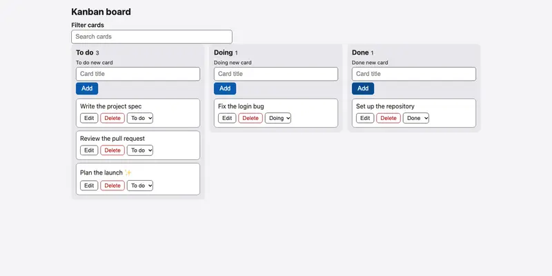
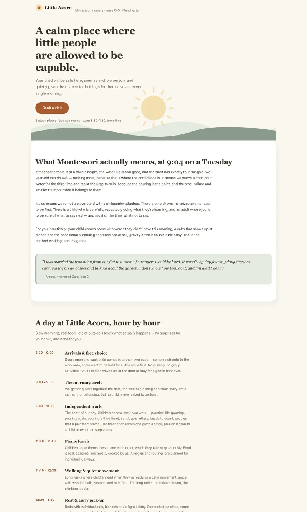
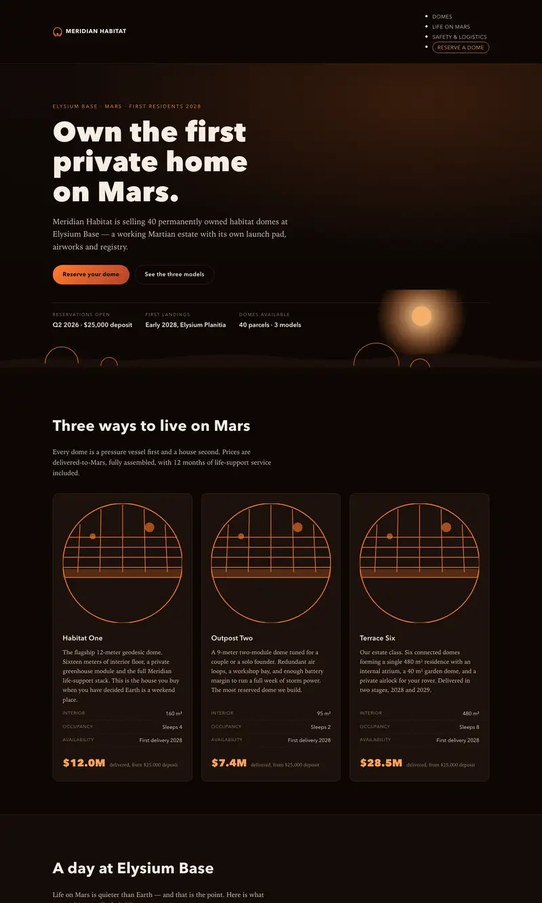

# Qwen3.8 27B, UD-IQ3_XXS (10.9 GB), 32k context, thinking off, MTP

## TLDR

**Verdict:** Not adopted. The model has potential but is limited on this 24 GB machine: in one Tier 3 run it beat
MiniCPM's median on three of seven tasks (Go 100, nursery 100, Mars 100), but it scored 0 on insight, runs at half
MiniCPM's speed and still fails the 60 s Tier 1 limit at 151–159 s. MiniCPM stays the default.

| Check | Result |
|---|---|
| Tier 1 gate | Fail at the default 60 s: 151–159 s with MTP (133–142 s without), 3 of 3 runs on 25 October |
| Tier 2 (22 tasks; champion bar 22/22) | With MTP: 20, 22, 20; without MTP: 22, 22, 20 (relaxed 30-minute cap, 25 October) |
| Tier 3 (7 tasks) | One run: Go 100, cleaning 80, insight 0, Kanban 71, nursery 100, Mars 100, tax 93 |
| Quality | Ahead of MiniCPM's 6-run median on 3 of 7 tasks, behind on 4; single run |
| Time | Tier 3: 7.5 minutes on Kanban, 18–24 minutes elsewhere, none at its cap; decode 12–14 tok/s on code with MTP (6.7 without) |
| Memory pressure | Minimum free memory 12–14%; swap up 0.35 GB on Mars, under 0.1 GB on every other task |

**Against the champion:** MiniCPM-V 4.7 IQ2 medians over 6 runs are Go 88, cleaning 90.5, insight 40, Kanban 90,
nursery 93, Mars 95, tax 98, at 3.5–22 minutes per task, and it passes the default gate.

## Details

- **Setup:** Pi with thinking off (`chat-template-kwargs = '{"enable_thinking":false}'`), 32k context, Unsloth
  UD-IQ3_XXS with Unsloth's MTP head (`MTP/` folder, Q4_0, 1.4 GB) through llama.cpp build 11960 and pill 0.4.1:

  ```toml
  [model.preset]
    chat-template-kwargs = '{"enable_thinking":false}'
    spec-type = "draft-mtp"
    spec-draft-model = "~/.pill/drafts/mtp-Qwen3.8-27B-Q4_0.gguf"   # full path in models.toml
    spec-draft-ngl = 99
  ```

  A 300-token coding answer ran at 12.2 and 13.7 tok/s with 70–77% of drafts accepted.
- **Runs:** one run per task, 1 to 2 November 2026 (22:35 to 00:49), on an otherwise idle machine. No task hit its cap.
- **Insight 0:** after 25 tool calls exploring the data, two replies hit the 8,192-token output limit (`max_tokens`)
  and Pi ended the session before any report, predictions or charts were written. A higher `max_tokens` might fix it;
  not tested.
- **Kanban 71:** the board renders and adds cards, but the verifier could not click Delete or use the move select
  (Playwright timed out on the locators), so delete, move, order and persistence checks scored 0.
- **Cleaning 80:** country codes matched 26.5% and the churn flag 60.9%; the other columns matched 82–97%.
- **Caveats:** single run, so differences of a few points are not findings; MiniCPM's own runs vary by tens of points.
  The gate failure is prompt processing on a dense model, which MTP does not speed up; a smaller quant or a
  different offload setting would not bring Tier 1 near 60 s either.

## Tested so far, and what would justify a re-test

All on this 24 GB M4 with Unsloth's UD-IQ3_XXS (10.9 GB). The files were deleted on 2 November; `pill pull` them again
to re-test.

| Setting | When | Result |
|---|---|---|
| Thinking on, 64k | 14 Oct, build 11429 | Tier 1 130–144 s; Tier 2 0/22 (8,192-token thinking block, no tool call) |
| Thinking off, 64k | 25 Oct (PILL-8) | Tier 1 133–142 s; Tier 2 22, 22, 20 at 6.7 tok/s |
| Thinking off, MTP, 16k | 25 Oct (PILL-8) | Decoding 16–18 tok/s; lowest free memory 7%; no full gate run |
| Thinking off, MTP, 32k | 25 Oct (PILL-10) | Tier 1 151–159 s; Tier 2 20, 22, 20 with two runs looping; 14.8 tok/s |
| Thinking off, MTP, 32k, Tier 3 | 1 Nov, build 11960 | The scores above, one run per task |

Do not re-test for the Tier 1 gate on this machine. It is a dense model, so the 7,400-token prompt is bound by prompt
processing: a smaller quant, a different offload setting or MTP does not bring it near 60 s, and a larger quant does
not fit. Re-test only for one of these:

- **A faster or larger machine**, where Tier 1 could pass at all.
- **A pill change that relaxes Tier 1** for slow, high-quality models.
- **Insight with a higher reply limit** (`max_tokens` above 8,192), the one cheap check left: it would show whether the
  0 is the limit or the model.

## What it looks like

| Task | Screenshot | Automated | Blind rating |
|---|---|---|---|
| Kanban (five cards added through the UI) |  | 71 | not rated |
| Nursery landing page |  | 100 | not rated |
| Mars landing page |  | 100 | not rated |
| Tax landing page |  | 93 | not rated |

## Sources

Gate runs: [`tried-and-rejected.md`](tried-and-rejected.md#qwen38-27b-thinking-and-mtp). Comparison:
[`summary.md`](summary.md). Raw runs are in `evals/results/` (not committed), folders `20261101T223508` to
`20261102T003036` for agent `pi:qwen38-27b-iq3xxs-mtp-32k`.
